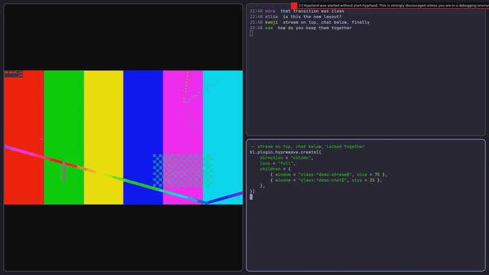
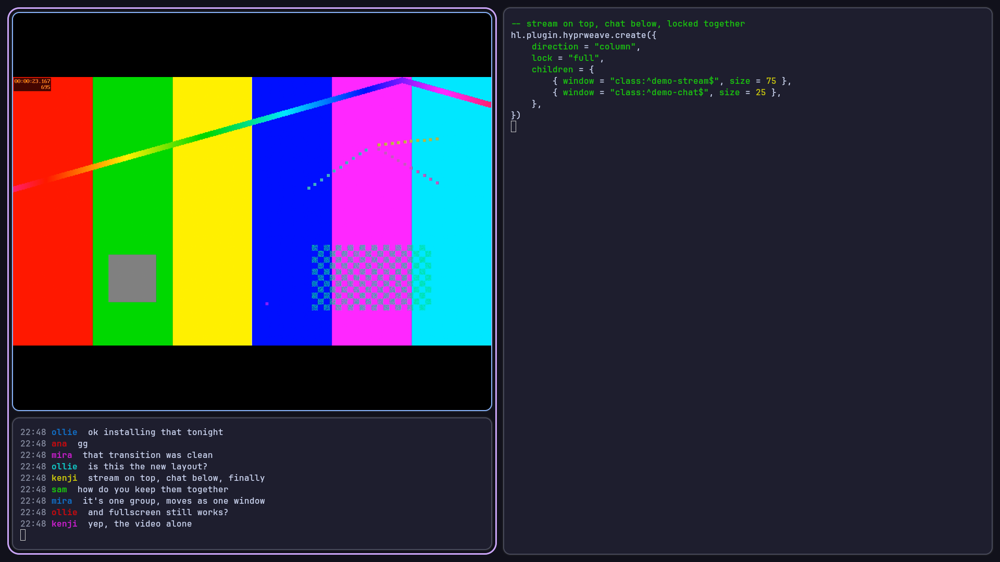
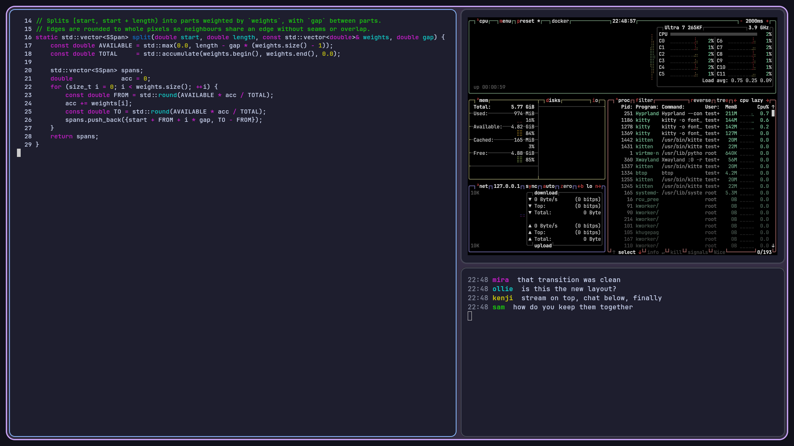
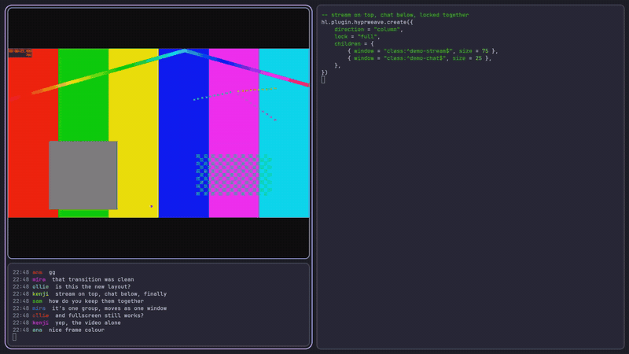

# hyprweave

A Hyprland plugin that turns groups into flex-style containers. Instead of tabs, every window in a group stays visible and gets a share of the group's tile: side by side, stacked, or nested, with sizes you set from Lua. The group still behaves like one window: it tiles, moves, floats and changes workspace as a unit, in every layout.



> **Alpha.** hyprweave 0.1.0 is the first release. It works with Hyprland 0.57.0 and the Lua config, on x86_64. The API may still change.

## Install

```sh
hyprpm update
hyprpm add https://github.com/beastyrabbit/hyprweave
hyprpm enable hyprweave
hyprpm reload
```

To load it on every login, see [install.md](docs/user/install.md), which also covers building from source.

## Use

Groups are created from Lua: from your config, a keybind, or `hyprctl repl` in a script.

```lua
-- stream on top (75%), chat below (25%), locked together
hl.plugin.hyprweave.create({
    direction = "column",
    lock = "full",
    children = {
        { window = "class:^mpv$", size = 75 },
        { window = "class:^chatterino$", size = 25 },
    },
})
```



Containers nest. Each group can have its own spacing and a background colour behind its members:

```lua
hl.plugin.hyprweave.create({
    direction = "row",
    gap = 10,
    background = "rgba(cba6f730)",
    children = {
        { window = "class:^code$", size = 58 },
        { size = 42, direction = "column", children = {
            { window = "class:^btop$", size = 60 },
            { window = "class:^chat$", size = 40 },
        } },
    },
})
```



## What a group does

- **Fullscreen**: fullscreening a member shows it alone; `hl.plugin.hyprweave.fullscreen()` fullscreens the whole group with its split.
- **Closed to outsiders**: windows join only through `create`. Moving or dragging another window onto a group never adds it, and moving a member moves the group.
- **Locks**: `lock = "full"` also closes the whole group when one member closes. Good for windows that belong together, like a stream and its chat.
- **Frame**: one border goes around the whole group, in its own colours, where a single window's border would be.
- **Unload-safe**: unloading the plugin turns every group back into a normal tab group. No window is closed.



The videos are also available as MP4: [create.mp4](docs/media/create.mp4), [fullscreen.mp4](docs/media/fullscreen.mp4).

## Documentation

- [Install](docs/user/install.md): hyprpm, loading at login, building from source.
- [Lua API and settings](docs/user/lua-api.md): `create`, `lock`, `dissolve`, `fullscreen`, `get`, and every `plugin:hyprweave` option.
- For contributors: [architecture](docs/dev/architecture.md), [testing](docs/dev/testing.md), [releasing](docs/dev/releasing.md), and [Hyprland plugin basics](docs/dev/basics/README.md).

## Not there yet

- No keyboard or mouse editing of a group's layout; sizes come from `create`.
- Directional focus inside a group follows Hyprland's own order, not the tree.
- No tabbed containers inside a group.

## License

[MIT](LICENSE)
